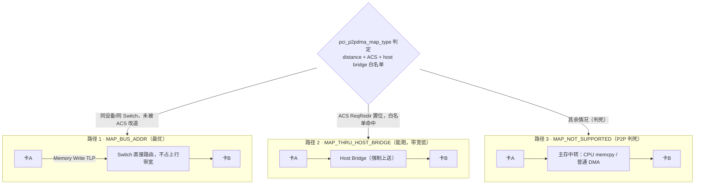

# 多卡互联设计

> **前置**：[[01_PCIE协议核心]]　|　**相关**：[[06_零拷贝专题]]　|　**进度**：[[学习进度追踪]]

> 目标：让多张卡高速协作，绕过 CPU / 内存成为瓶颈。核心是**地址路由**与**一致性**两个问题。

## 0. 先理解"为什么难"

单卡时，数据通路是 `卡 → PCIe → CPU/内存`。多卡协作时 naive 做法是：
```
卡A → 内存 → CPU 拷贝 → 内存 → 卡B     ❌ 两次穿越 PCIe + CPU 搬运，慢且占 CPU
```
多卡互联方案的本质：**让卡A 直接把数据送进卡B，不经过 CPU，甚至不经过主存**。

## 1. PCIe P2P（Peer-to-Peer）

- 让两张 EP 之间直接发 TLP，不经过 RC/主存。
- **同 Switch 下的 P2P 走的是 PCI 总线地址空间，由 Switch 直接路由，不经过 IOMMU 翻译**——这是最容易被讲错的一点。
- IOMMU/ACS 在这里扮演的是"**限制者**"而非"使能者"：ACS 的 **P2P Request Redirect** 位若置位，P2P TLP 会被强制上送到 RC；此时只有 host bridge 在内核 `pci_p2pdma_whitelist` 白名单中才仍可 P2P（映射类型为 `THRU_HOST_BRIDGE`），否则返回 `NOT_SUPPORTED`。
- 流程：卡A 把目的地址设成卡B 暴露的 **bus address**（BAR 物理地址 + bus_offset）→ 发 Memory Write TLP → Switch 路由到卡B。
- Linux 基础设施：`pci_p2pdma_*` API（`include/linux/pci-p2pdma.h`），NVMe-oF、GPUDirect 等用。
- 坑：ACS redirect、host bridge 白名单、地址对齐、目标 BAR 是否允许被其他设备访问。

> 完整判定链路（IOMMU / ACS / 白名单 / ATS）见 [[15_IOMMU_ACS与P2P可行性]]。

```
CPU/RC
  │
Switch ──→ 卡A (EP)
  └──────→ 卡B (EP)
        卡A → 卡B 走 Switch 内部，不占上行带宽 ✅
```

> 图示：同一对卡的三种数据路径，由 `enum pci_p2pdma_map_type` 的判定结果决定走哪条。`preflight.sh` 抓的 ACS ReqRedir 位、`pci_p2pdma_distance()` 的返回值，最终都是在区分这三条路。



## 2. NVLink / 私有高速互联（GPU 场景）

- NVLink、AMD Infinity Fabric、华为 HCCS 等：**专有链路**，带宽远超 PCIe，且**支持跨卡缓存一致性**。
- 拓扑不是树，而是**网格/全互联**（如 DGX 里 8 卡全连）。
- 一致性域把多卡显存统一成一个可寻址空间（如 CUDA Unified Memory）。

## 3. CXL（Compute Express Link）—— 新一代互联

- 基于 PCIe 物理层，但协议扩展到 **CXL.io + CXL.cache + CXL.mem**。
- 关键能力：**内存一致性 + 共享内存语义**。设备可作为"有类型内存设备"挂进一致性域。
- CXL 2.0+ 支持多主设备（multi-head）、内存池化（memory pooling）、fabric 交换。
- 类型：Type1（加速器）、Type2（带内存的加速器如 GPU/HBM）、Type3（内存扩展条）。

| 方案 | 带宽 | 一致性 | 成熟度 | 典型场景 |
|------|------|--------|--------|---------|
| PCIe P2P | 中（受 PCIe 限制） | 弱（软件/单向） | 高 | 存储/网络 offload |
| NVLink/IF | 高（>PCIe 数倍） | 强（缓存一致） | 高（NVIDIA/AMD） | GPU 集群训练 |
| CXL | PCIe 物理层 | 强（内存一致） | 发展中 | 内存池化、异构加速 |

## 4. 设计一个多卡互联方案（方法论）

1. **确定通信模式**：是流式（A 持续推给 B）还是随机访问（共享显存）？
2. **选互联**：同机柜 GPU 选 NVLink；通用 PCIe 平台选 P2P；需要内存共享/池化选 CXL。
3. **地址规划**：谁暴露 BAR 给谁？IOMMU 如何映射？是否需要 `pci_p2pdma` 映射对端资源？
4. **一致性策略**：用软件同步（屏障/flag）还是硬件一致性（NVLink/CXL）？
5. **拓扑感知调度**：软件要知道"哪两张卡近"（PCIe 同 Switch 优先 P2P）。
6. **错误处理**：AER、链路重训、热插拔下的对端失效。

## 5. 软件栈分层（设计参考）

```
应用/框架层 (NCCL / MPI / 自定义 runtime)
        │
一致性 / 集合通信层（all-reduce 等优化，拓扑感知）
        │
传输层：PCIe P2P  |  NVLink  |  CXL.mem
        │
驱动层：本卡驱动 + p2pdma + IOMMU 映射
        │
硬件：EP / Switch / RC / 互联链路
```

## 6. 驱动里支持 P2P 的关键步骤（简化）

```c
#include <linux/pci-p2pdma.h>

/* ① 判断两卡能否 P2P —— 这个接口从 4.20 起签名一直没变 */
int dist = pci_p2pdma_distance(b, &a->dev, false);   /* b=provider, a=client */
if (dist < 0)
        return -EOPNOTSUPP;      /* ACS redirect 且 host bridge 不在白名单，或跨域 */

/* ② 取得可用的总线地址 —— 按内核版本三选一 */

/* 6.15 及以前：没有公开的"映射资源"函数。
 * provider 侧：pci_p2pdma_add_resource(pdev, bar, size, offset)
 *              + pci_p2pmem_publish(pdev, true)
 * client 侧  ：把 p2p 页直接交给 dma_map_sg()，由 dma-direct / IOMMU 层
 *              内部判定走 BUS_ADDR 还是 THRU_HOST_BRIDGE。
 * 注：历史资料里流传的 pci_p2pdma_map_resource() 从未进入过主线，勿照抄。 */

/* 6.16 ~ 6.18：显式状态结构 */
struct pci_p2pdma_map_state st;
if (pci_p2pdma_state(&st, &a->dev, page) == PCI_P2PDMA_MAP_BUS_ADDR)
        dma_addr = pci_p2pdma_bus_addr_map(&st, page_to_phys(page));

/* 6.19+：provider 模型 */
if (pcim_p2pdma_init(b))                       /* 返回 int，不是 IS_ERR */
        return -EOPNOTSUPP;
prov = pcim_p2pdma_provider(b, bar);
if (pci_p2pdma_map_type(prov, &a->dev) == PCI_P2PDMA_MAP_BUS_ADDR)
        dma_addr = pci_p2pdma_bus_addr_map(prov, paddr);
```

> 三个版本的完整对照、以及"为什么 6.19 又改了一次"，见 [[dev_case_02_p2pdma]] 第三节。

> 实战要点：先用 `lspci -t` 看拓扑，确认两卡是否同 Switch；再用内核 p2pdma API 建立映射；最后测带宽对比"经 CPU"路径的加速比。

## 7. 自检

- P2P 为什么比经 CPU 快？依赖哪些硬件支持？
- NVLink 相比 PCIe P2P 多了什么？（带宽 + 一致性）
- CXL 的三种协议各自干什么？
- 设计多卡方案时要回答哪 6 个问题？

---

## 🔗 关联笔记

- **前置**：[[01_PCIE协议核心]]（拓扑/IOMMU/DMA 基础）
- **强相关**：[[06_零拷贝专题]]（多卡零拷贝 = 层次 3）
- **P2P 能不能通**：[[15_IOMMU_ACS与P2P可行性]]（ACS 与 host bridge 白名单）· [[18_内核版本适配矩阵]]（本篇三段 P2PDMA 写法对应哪个内核）
- **⭐ 深化子库**：本篇讲"硬件怎么连"，完整的多卡通讯技术栈（软件栈/集合通信/NCCL/RDMA/性能调优）见 [[07_多卡通讯总览]] 开始的 7 篇子库
- **返回**：[[00_首页MOC]]　**自测**：[[05_面试与原理问答]]

## 📝 我的学习记录

- **YYYY-MM-DD**：
