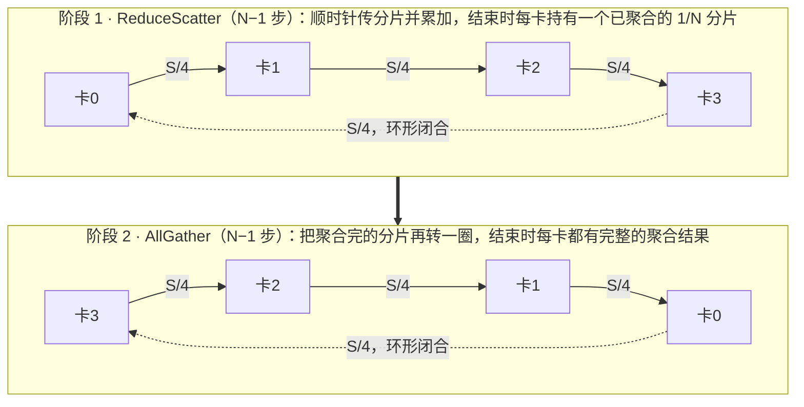

# 08 · 集合通信原语

> **前置**：[[07_多卡通讯总览]]　|　**下一站**：[[09_并行策略与通讯模式]]　|　**进度**：[[学习进度追踪]]

> 集合通信 = 所有参与的卡一起执行同一套操作，每张卡既是发送者也是接收者。这是分布式训练的基础。

---

## 一、5 大集合通信操作（必懂）

### 1. Broadcast（广播）
```
初始:  卡0=[1,2,3]  卡1=[]  卡2=[]  卡3=[]
最终:  卡0=[1,2,3]  卡1=[1,2,3]  卡2=[1,2,3]  卡3=[1,2,3]
```
**场景**：
- 广播模型参数（初始化时所有卡从 rank0 拿参数）
- 广播控制信号

**实现**：二叉树（log N 步）或链式（N-1 步）

### 2. Reduce（归约）
```
初始:  卡0=[1]  卡1=[2]  卡2=[3]  卡3=[4]
最终:  卡0=[10]（其他卡无数据）        op=sum
```
**op 可以是**：sum / max / min / prod
**场景**：loss 求和、准确率聚合

### 3. AllReduce（全员归约）⭐ 最常用
```
初始:  卡0=[1]  卡1=[2]  卡2=[3]  卡3=[4]
最终:  卡0=[10]  卡1=[10]  卡2=[10]  卡3=[10]   op=sum
```
**场景**：
- **数据并行梯度同步**（最重要！每张卡算完梯度后 AllReduce）
- loss 归约（所有卡都拿到全局 loss）

**为什么是命脉**：每个训练步都要做 1～2 次 AllReduce，通信量约等于模型参数量。

### 4. AllGather（全员聚合）
```
初始:  卡0=[1]  卡1=[2]  卡2=[3]  卡3=[4]
最终:  卡0=[1,2,3,4]  卡1=[1,2,3,4]  卡2=[1,2,3,4]  卡3=[1,2,3,4]
```
**场景**：
- **张量并行**：每张卡算一部分，最后 AllGather 拼接完整结果
- 序列并行的 attention 输出拼接

### 5. ReduceScatter（归约分片）
```
初始:  卡0=[1,2,3,4]  卡1=[1,2,3,4]  卡2=[1,2,3,4]  卡3=[1,2,3,4]
最终:  卡0=[4]  卡1=[8]  卡2=[12]  卡3=[16]        op=sum，每卡拿分片
```
**场景**：
- **张量并行梯度同步**：聚合后分片存储，节省显存
- ZeRO 优化的梯度分片

---

## 二、AllReduce 的三种实现（必懂原理）

### 1. Ring AllReduce（NCCL 默认）
```
步骤（4 张卡，sum）：
  卡0 → 卡1 → 卡2 → 卡3 → 卡0   (环)

  阶段1（Reduce-Scatter，N-1 步）：
    卡0 发 1/4 给卡1，卡1 累加
    卡1 发 1/4 给卡2，卡2 累加
    ...（每步每卡发 1/N 数据）

  阶段2（AllGather，N-1 步）：
    反向再绕一圈，把完整结果广播
```

> 图示：两阶段各绕环一圈，**每步每卡只发送 1/N**（图中 S/4），所以环永远不会成为瓶颈——这就是 Ring 带宽最优的结构性原因。



**每卡通讯量**：`2 × (N-1)/N × S` ≈ `2S`（N 大时，单卡视角）
**带宽效率**：接近理论峰值（每卡同时收发）

### 2. Tree AllReduce
```
二叉树归约：叶子 → 父节点 → 根 → 再广播
```
**每卡通讯量（近似）**：`2 × log2(N) × S`
**优点**：延迟低（log N 步）
**缺点**：带宽利用率不如 Ring（同样的数据被重复搬运）
**适用**：小数据 / 小 N

### 3. Ring + SHARP（In-Network Aggregation）
```
数据送到交换机，交换机内做归约，再分发
```
**优点**：通讯量减半（只在交换机和端点间传输）
**缺点**：需要支持 SHARP 的交换机（ expensive）
**适用**：InfiniBand 集群

---

## 三、NCCL 的算法选择

NCCL 并**不按固定的 64KB/1MB 阈值**选算法。它内置 tuner（且支持外部 tuner 插件），综合**消息大小、拓扑（NVLink/PCIe/IB 的层级与跳数）、channel 数、协议**做决策，并可能把一次集合操作拆成多个算法组合（如"机内 NVLS + 机间 Ring"）。

**经验规律（仅作直觉，不是规则）**：

| 场景 | 倾向 |
|------|------|
| 极小消息（几 KB 级） | 低延迟优先：Tree / LL 协议 |
| 中大消息 | 带宽优先：Ring / Simple 协议 |
| NVLink 域内有 NVSwitch | NVLS（交换机内归约），可显著减少显存往返 |
| IB + 支持 SHARP 的交换机 | CollNetChain / CollNetDirect |

> `NCCL_ALGO` 的可选值：`Ring`、`Tree`、`CollNetChain`、`CollNetDirect`、`NVLS`、`NVLSTree`、`PAT`。**强制指定通常不会更快**，只在定位问题或做对照实验时使用。

---

## 四、用 NCCL 写一个 AllReduce

### C/C++ 版本
```c
#include <nccl.h>
#include <cuda_runtime.h>

int main() {
    // 初始化
    int nDev = 2;
    ncclComm_t comms[nDev];
    int devs[nDev] = {0, 1};
    ncclCommInitAll(comms, nDev, devs);

    // 数据（每卡各有一份）
    float* sendbuff[nDev];
    float* recvbuff[nDev];
    int size = 1024 * 1024; // 1M floats
    cudaStream_t streams[nDev];

    for (int i = 0; i < nDev; i++) {
        cudaSetDevice(devs[i]);
        cudaMalloc(&sendbuff[i], size * sizeof(float));
        cudaMalloc(&recvbuff[i], size * sizeof(float));
        cudaStreamCreate(&streams[i]);
        // 初始化数据 ...
    }

    // AllReduce
    for (int i = 0; i < nDev; i++) {
        ncclAllReduce(sendbuff[i], recvbuff[i], size,
                      ncclFloat, ncclSum, comms[i], streams[i]);
    }

    // 同步
    for (int i = 0; i < nDev; i++) {
        cudaSetDevice(devs[i]);
        cudaStreamSynchronize(streams[i]);
    }

    // 清理
    for (int i = 0; i < nDev; i++) {
        ncclCommDestroy(comms[i]);
    }
    return 0;
}
```

### PyTorch 版本（更常用）
```python
import torch
import torch.distributed as dist

# 初始化
dist.init_process_group(backend='nccl')
rank = dist.get_rank()
world_size = dist.get_world_size()
torch.cuda.set_device(rank)

# 数据
tensor = torch.ones(1024, 1024).cuda() * (rank + 1)

# AllReduce
dist.all_reduce(tensor, op=dist.ReduceOp.SUM)

# 所有 rank 现在都有 sum
print(f"Rank {rank}: {tensor[0, 0].item()}")  # 应输出 world_size
```

---

## 五、集合通信 vs 点对点

| 对比项 | 集合通信 | 点对点 |
|--------|---------|--------|
| **参与者** | 所有卡同时参与 | 两卡一对一 |
| **同步性** | 阻塞 / 非阻塞 | 阻塞 / 非阻塞 |
| **典型操作** | AllReduce, AllGather | Send/Recv |
| **场景** | 数据/张量并行 | 流水线并行 |
| **实现** | NCCL/MPI 集合通信 | NCCL/MPI P2P |
| **优化难度** | 高（要拓扑感知） | 中 |

---

## 六、常见误区（逐条纠正）

| 常见说法 | 正解 |
|---------|------|
| "AllReduce = AllGather + Reduce" | **错**。数学上 `AllReduce = ReduceScatter + AllGather`（先分片归约、再聚合）。写成 AllGather+Reduce 的组合既多一次通讯、语义也不等价（Reduce 只留一个结果）。 |
| "小数据就该换 AllReduce" | **混淆了操作与算法**。操作仍是 AllReduce；变的是**算法/协议**（Tree / LL）。换操作解决不了延迟问题。 |
| "集合通信必须所有卡同步阻塞" | **半对**。NCCL 调用本身异步（挂在 stream 上），可做通讯-计算重叠；但**语义上所有 rank 必须参与且顺序一致**，否则会 hang——异步不等于可以缺席。 |
| "Ring AllReduce 的通讯量与 N 无关" | **精确说**：单卡搬运量 `2(N-1)/N·S`，**趋于 2S 但严格小于 2S**，且随 N 增大而增大（趋近饱和）。"与 N 无关"是渐近说法。 |
| "Tree 一定比 Ring 快/慢" | 取决于消息大小与 N。小消息 Tree 的 log N 步占优；大消息 Ring 的链路利用率占优。 |

> 一个实用的自查：如果某条"优化结论"没有说明**是单卡视角还是全局视角、是单向还是双向**，它大概率是错的——这正是本库专门加 [[17_带宽与单位换算速查]] 的原因。

---

## 七、自检

- [ ] 能画出 5 大集合通信操作的数据流
- [ ] 能解释为什么 AllReduce 是分布式训练的命脉
- [ ] 能说出 Ring AllReduce 的通讯量公式 `2 × (N-1)/N × S`
- [ ] 理解为什么小数据用 Tree、大数据用 Ring
- [ ] 能用 PyTorch 写一个 AllReduce 例子

---

## 🔗 关联笔记

- **前置**：[[07_多卡通讯总览]]
- **下一站**：[[09_并行策略与通讯模式]]
- **相关**：[[10_NCCL实战与调试]]（NCCL 实际使用）
- **返回**：[[00_首页MOC]]

## 📝 我的学习记录

- **YYYY-MM-DD**：
