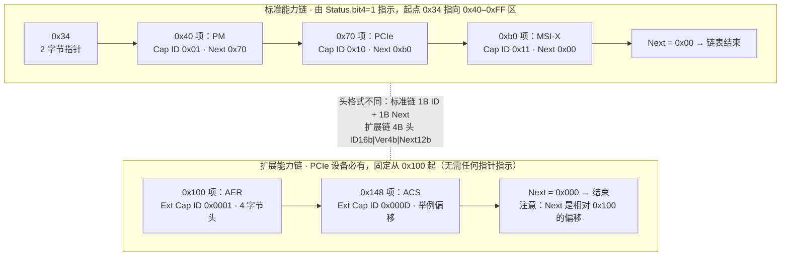
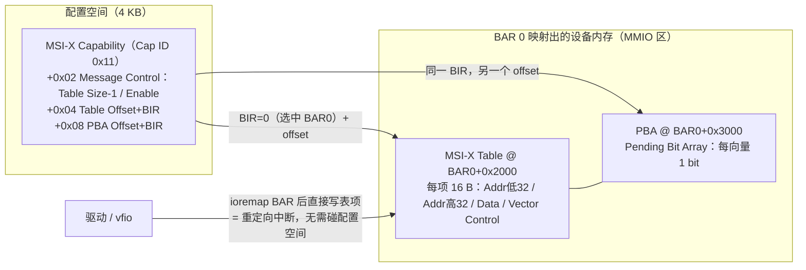

# 14 · 配置空间与能力链表详解

> **为什么需要这篇**：驱动出问题，一半以上能在这 4KB 里找到答案——BAR 分错了、Bus Master 没开、MSI-X 表在哪个 BAR、AER 报了哪类错。
> **本文所有偏移量均以 Linux `include/uapi/linux/pci_regs.h` 为准**，不是凭记忆写的。

---

## 一、三种地址空间，先分清

| 空间 | 大小 | 访问方式 | 典型用途 |
|------|------|---------|---------|
| **配置空间** | 256 B（PCI）/ **4 KB**（PCIe） | `pci_read_config_*` / ECAM | 身份、能力、BAR、中断配置 |
| **MMIO** | 由 BAR 描述 | `ioremap` + `readl/writel` | 设备寄存器、doorbell、队列 |
| **I/O 空间** | 64 KB（x86） | `in/out` | 老设备，现代 PCIe 基本不用 |

PCIe 的 4 KB 配置空间由 **ECAM**（Enhanced Configuration Access Mechanism，ACPI MCFG 描述）提供，映射到一段 MMIO：

```
配置地址 = ECAM_BASE + (bus << 20) | (dev << 15) | (func << 12) | (offset & 0xFFF)
```

前 256 B 与老 PCI 兼容；**0x100–0xFFF 是"扩展配置空间"**，AER、ACS、SR-IOV、ATS 等都在这里。

```bash
lspci -xxx  -s 01:00.0    # dump 256 B
lspci -xxxx -s 01:00.0    # dump 4 KB（需要 root 与 ECAM 支持）
```

---

## 二、Type 0 头部（普通设备）逐字段

| 偏移 | 字段 | 驱动关心什么 |
|------|------|-------------|
| 0x00 | Vendor ID | `pci_device_id` 匹配 |
| 0x02 | Device ID | 同上 |
| 0x04 | **Command** | **bit1 开 MMIO、bit2 开 Bus Master** |
| 0x06 | Status | bit4 = 有 Capability 链表；bit8 = 主设备数据奇偶错 |
| 0x08 | Revision ID | 区分芯片版本（同一 Device ID 多版本时有用） |
| 0x09 | Programming Interface | 同类设备的编程模型（如 NVMe 的 01/02） |
| 0x0A | Sub Class | 细分类型（如 0x08 = NVMe） |
| 0x0B | Class Code | 大类（0x01 存储 / 0x02 网络 / 0x03 显示 / 0x12 加速器） |
| 0x0E | Header Type | bit7=1 为多功能设备；低 7 位 0=普通/1=桥 |
| 0x10–0x24 | **BAR0–BAR5** | 六个体，64 位 BAR 占两个 |
| 0x2C | Subsystem Vendor ID | 板卡厂商（同一芯片不同板卡） |
| 0x2E | Subsystem ID | 板卡型号 |
| 0x30 | Expansion ROM BAR | 老式 option ROM |
| **0x34** | **Capabilities Pointer** | **能力链表头**（0x40 起） |
| 0x3C | Interrupt Line | 传统 INTx 的中断线（PCIe 下多为 0） |
| 0x3D | Interrupt Pin | 用 INTA#~INTD# 哪一根 |

### Command 寄存器（0x04）关键位

| 位 | 名称 | 含义 |
|----|------|------|
| 0 | I/O Space | 允许响应 I/O 空间访问 |
| 1 | Memory Space | **允许响应 MMIO** —— 不开则读写 BAR 全是 0xFFFFFFFF |
| **2** | **Bus Master** | **允许发起 DMA** —— `pci_set_master()` 就是置这一位 |
| 6 | Parity Error Response | 奇偶错上报 |
| 8 | SERR Enable | 系统错误上报 |
| 10 | Interrupt Disable | 屏蔽 INTx（与 MSI 无关） |

### Status 寄存器（0x06）关键位

| 位 | 名称 | 含义 |
|----|------|------|
| 3 | Interrupt Status | INTx 待处理 |
| **4** | **Capabilities List** | 1 = 存在能力链表（PCIe 设备必为 1） |
| 8 | Master Data Parity Error | 主设备数据奇偶错 |
| 11 | Signaled Target Abort | 本设备以 Target Abort 终止事务 |
| 12 | Received Target Abort | 收到 Target Abort（**地址写错/对端不存在**的典型信号） |
| 13 | Received Master Abort | 同上，主设备侧 |
| 14 | Signaled System Error | 上报了 SERR |
| 15 | Detected Parity Error | 检测到奇偶错 |

---

## 三、Type 1 头部（桥 / Switch 端口）

桥的头部复用 0x18 之后的空间，**不叫 BAR，而是总线号与窗口**：

| 偏移 | 字段 | 含义 |
|------|------|------|
| 0x18 | Primary Bus Number | 上游总线号 |
| 0x19 | Secondary Bus Number | **下游总线号**（枚举时分配） |
| 0x1A | Subordinate Bus Number | 下游所有总线的最大号 |
| 0x1C / 0x1D | I/O Base / Limit | I/O 窗口 |
| 0x20 / 0x22 | Memory Base / Limit | 非预取内存窗口 |
| 0x24 / 0x26 | Prefetchable Base / Limit | 可预取内存窗口 |
| 0x28 / 0x2C | Prefetchable Base/Limit Upper 32 | 64 位窗口高 32 位 |
| 0x3E | Bridge Control | 包括 SERR、奇偶错转发等 |

> 调试拓扑时，`lspci -t` 显示的层级就是这三个总线号算出来的。**"下游总线号没分配"是枚举失败最典型的表现**（表现为 `lspci` 看不到下挂设备）。

---

## 四、BAR：编码、尺寸与 64 位陷阱

### 4.1 低 4 位的编码

| 位 | 含义 |
|----|------|
| 0 | 0 = Memory 空间，1 = I/O 空间 |
| 2:1 | Memory 类型：`00` = 32 位，`10` = 64 位 |
| 3 | 1 = 可预取（Prefetchable） |

例：读 BAR0 = `0x0000000C` → `0b1100`：bit0=0（Memory）、bit2:1=10（**64 位**）、bit3=1（**可预取**）→ 它占用 BAR0+BAR1 两个槽，实际基地址要拼 BAR1 的高 32 位。

### 4.2 尺寸探测："写全 1"法

硬件把 BAR 中"不可改写的位"固定住，因此：

```
1. 保存原值 orig = read(BAR)
2. 写 0xFFFFFFFF
3. 读回 mask
4. size = ~(mask & ~0xF) + 1          // 32 位
5. 恢复 orig = write(BAR)
```

例：读回 `0xFFFFF000` → size = ~0xFFFFF000 + 1 = 0x1000 = 4 KB。

> ⚠️ **不要在活设备上随手做这件事**（会临时改写地址译码）。这本来是固件枚举阶段的活；驱动只该用 `pci_resource_len()` 读结果，不要自己探测。

### 4.3 三个高频坑

1. **64 位 BAR 占两槽**：BAR2 是 64 位，则 BAR3 不可用，实际地址 = BAR3<<32 | (BAR2 & ~0xF)。
2. **BAR 可能没被固件分配**：`pci_resource_start()` 返回 0 而 len 非 0，说明需要内核重新分配（`pci=realloc`）。
3. **`pci_request_regions()` 失败**：不是 BAR 坏了，而是**已被其他驱动占用**（`-EBUSY`）。

---

## 五、能力链表：从 0x34 走一遍

```
Status.bit4 = 1
        │
        ▼
0x34 ──► [Cap ID][Next Ptr][...数据...] ──► [Cap ID][Next Ptr][...] ──► 0x00 结束
          0x40 起，8 位对齐
```

遍历规则：起点是 0x34 的字节（0 表示无能力），每项第一个字节是 Cap ID，第二个字节是下一个偏移。**必须做环检测与越界检测**，否则坏设备会让内核死循环。

> 图示：4 KB 配置空间里有**两条独立的链表**，起点、头格式、Next 的含义都不同。这是读 `lspci -vvv` 时"Capabilities: [xx]"（标准链）与 "Capabilities: [xxx v1]"（扩展链）两段输出的来源。



### 标准 Capability ID（0x40–0xFF 区）

| ID | 能力 | 说明 |
|----|------|------|
| 0x01 | Power Management | 电源状态 D0–D3 |
| 0x03 | VPD | 厂商自定义信息 |
| **0x05** | **MSI** | 消息中断 |
| 0x09 | Vendor Specific | 厂商私有 |
| 0x0C | PCI Hot-Plug | 热插拔 |
| 0x0D | Subsystem Vendor ID | 子系统 ID |
| **0x10** | **PCI Express** | 链路能力/状态/控制（LnkCap/LnkSta 就在这里） |
| **0x11** | **MSI-X** | 多向量中断 |
| 0x13 | PCI Advanced Features | AF |

### 扩展 Capability ID（0x100+ 区）

| ID | 能力 | 为什么关心 |
|----|------|-----------|
| 0x0001 | **AER** | 错误分级与计数（见 [[16_AER错误处理与链路稳定性]]） |
| 0x0002 | Virtual Channel | QoS/优先级 |
| 0x0003 | Device Serial Number | 唯一标识 |
| **0x000D** | **ACS** | **P2P 是否被改道**（见 [[15_IOMMU_ACS与P2P可行性]]） |
| 0x000E | ARI | 多功能设备扩展功能号 |
| 0x000F | ATS | 设备侧地址翻译缓存 |
| **0x0010** | **SR-IOV** | 虚拟功能（VF） |
| 0x0013 | PRI | 页请求（按需调页） |
| 0x0015 | Resizable BAR | BAR 尺寸可调 |
| 0x001B | PASID | 进程地址空间 ID |
| 0x001D | **DPC** | 下游端口隔离（错误遏制） |
| 0x001E | L1 PM Substates | 低功耗链路状态 |
| 0x002E | DOE | 数据对象交换（新式管理通道） |

> 注意：**扩展能力也是链表，但头部格式不同**——每项 4 字节头：`Cap ID(15:0) | Version(19:16) | Next Offset(31:20)`，链表起点固定为 **0x100**，Next 是**相对 0x100 的偏移**，值为 0 表示结束。遍历代码不能照搬 0x40 区那套（那里是 1 字节 ID + 1 字节 Next）。

---

## 六、MSI 与 MSI-X 的结构差异

### MSI（Cap ID 0x05）

| 偏移 | 字段 |
|------|------|
| +0x00 | Cap ID / Next |
| +0x02 | Message Control（bit0 使能、bit7 支持 64 位地址、bit8 支持逐向量屏蔽） |
| +0x04 | Message Address（低 32 位） |
| +0x08 | Message Address 高 32 位（若 64 位）**或** Message Data（32 位设备） |
| +0x0C | Message Data（64 位设备）**或** Mask（32 位设备） |

MSI **只有一个地址/数据对**，多向量靠"数据值不同"区分，向量数受 Message Control 的 Multiple Message Enable 限制（最多 32）。

### MSI-X（Cap ID 0x11）

| 偏移 | 字段 | 说明 |
|------|------|------|
| +0x02 | Message Control | bit10:0 = **Table Size - 1**；bit14 = Mask All；bit15 = Enable |
| +0x04 | Table Offset / BIR | 低 3 位 = **哪个 BAR**，高位 = BAR 内偏移（8 字节对齐） |
| +0x08 | PBA Offset / BIR | 同上，指向 Pending Bit Array |

**Table 每项 16 字节**：

```
+0x00  Message Address (低 32)
+0x04  Message Address (高 32)
+0x08  Message Data
+0x0C  Vector Control（bit0 = Mask）
```

这就是为什么"MSI-X 表在 BAR 里"——驱动 `ioremap` 那个 BAR 后，可以直接改写表项来实现中断重定向（vfio 就是这么把中断搬到用户态的）。

> 图示：MSI-X 的 Cap 结构本身只有 12 字节，真正的中断表放在 **BAR 指向的内存**里——Cap 里的 `Table Offset / BIR` 字段是"指针的指针"。BIR 的低 3 位选中哪个 BAR，高位给出 BAR 内偏移。



```bash
# 看 MSI-X 能力与表位置
lspci -vvv -s 01:00.0 | grep -i -A3 "MSI-X"
#   Capabilities: [b0] MSI-X: Enable+ Count=64 Masked-
#   Vector table: BAR=0 offset=00002000
#   PBA: BAR=0 offset=00003000
```

---

## 七、驱动侧 API 与命令行对照

| 目的 | 内核 API | 命令行等价 |
|------|---------|-----------|
| 读配置 | `pci_read_config_dword(pdev, off, &val)` | `setpci -s BDF 0x10.l` |
| 找能力 | `pci_find_capability(pdev, PCI_CAP_ID_MSIX)` | `lspci -vv` 的 `Capabilities:` |
| 找扩展能力 | `pci_find_ext_capability(pdev, PCI_EXT_CAP_ID_AER)` | `lspci -vvv` 的 `Advanced Error` |
| BAR 地址/长度 | `pci_resource_start/len(pdev, bar)` | `lspci -vv` 的 `Region 0:` / sysfs `resource` |
| 映射 BAR | `pci_iomap(pdev, bar, len)` | —（用户态用 VFIO mmap） |
| 申请中断 | `pci_alloc_irq_vectors()` | `cat /proc/interrupts` |

**sysfs 快速核对**：

```bash
D=/sys/bus/pci/devices/0000:01:00.0
cat $D/vendor $D/device $D/class          # ID 与类别
cat $D/resource                            # 每行：start end flags（6 个 BAR + ROM）
cat $D/config | hexdump -C | head          # 二进制配置空间
readlink $D/driver                         # 当前绑定驱动
```

---

## 八、常见坑

| 现象 | 根因 | 定位 |
|------|------|------|
| 读 BAR 全是 `0xFFFFFFFF` | Command.Memory Space 未开，或 BAR 未分配 | 读 0x04 的 bit1；看 `lspci -vv` 的 `Region` |
| DMA 完全不工作 | Command.Bus Master 未开 | 0x04 的 bit2 |
| 设备"消失" | 桥的 Secondary/Subordinate Bus 号异常 | `lspci -t` 层级错乱 |
| MSI-X 申请到 1 条而非 N 条 | Table Size 就是 1，或 BAR 未映射 | `lspci -vvv` 的 `Count=` |
| 中断全打到 CPU0 | MSI-X 表项地址/数据相同（未按向量区分） | 读 table entry 对比 |
| `pci_request_regions` `-EBUSY` | BAR 被占用 | `lspci -k` 看 driver in use |

---

## 九、自检

- [ ] 能说出 Type 0 头部 0x04、0x10、0x34 三处的含义
- [ ] 能解释 Command 的 bit1 与 bit2 分别控制什么
- [ ] 会用"写全 1"法算 BAR 尺寸，并知道为什么驱动不该这么干
- [ ] 能说出 64 位 BAR 为什么占两个槽
- [ ] 能区分 0x40 区的能力链表与 0x100 区的扩展能力数组
- [ ] 能画出 MSI-X 能力的三个字段，并说明 table entry 的 16 字节布局
- [ ] 能在 `lspci -vvv` 输出里找到 LnkSta、MSI-X、AER、ACS 四块信息

---

## 🔗 关联笔记

- **协议心智模型**：[[01_PCIE协议核心]]
- **驱动主线**：[[02_Linux_PCIe驱动开发]]
- **错误处理**：[[16_AER错误处理与链路稳定性]]
- **P2P 判定**：[[15_IOMMU_ACS与P2P可行性]]
- **用户态访问**：[[lab_04_vfio_userspace]]
- **返回**：[[00_首页MOC]]

## 📝 我的记录

- **YYYY-MM-DD**：
