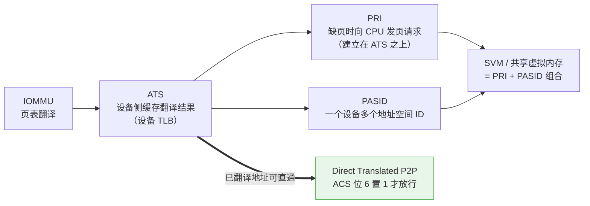

# 15 · IOMMU、ACS 与 P2P 可行性

> **要回答的问题**：为什么同样两张卡，在 A 机器上能 P2P、换到 B 机器就 `-1`？为什么"IOMMU 开了"有时反而不能 P2P，有时又没事？
> **一句话结论**：**P2P 不需要 IOMMU 帮忙，反而常被 ACS 拦下**。这两件事的因果关系，多数资料讲反了。

---

## 一、IOMMU 到底做什么

IOMMU（Intel VT-d / AMD-Vi / ARM SMMU）是**设备侧**的地址翻译与保护单元：

```
设备发出的 DMA 地址(IOVA) ──► [IOMMU] ──► 物理地址(PA) ──► 内存
                                 │
                                 └─ 权限检查：越界/未映射 → 拦截并报 fault
```

它解决三件事：

1. **隔离**：设备只能访问被显式映射的区域（防止野指针 DMA 写坏内核）。
2. **地址空间**：让 32 位设备也能 DMA 到 4G 以上（IOVA 可以映射到任意物理页）。
3. **虚拟化**：把物理设备直通给虚拟机（VFIO 的基础）。

**它不解决的问题**：设备 A 与设备 B 之间的直接数据通路。那条路在 Switch 内部，根本不经过 IOMMU。

---

## 二、关键认知：P2P 与 IOMMU 是"两条路"

| | 经 IOMMU 的 DMA | Switch 内 P2P |
|---|---|---|
| 地址类型 | IOVA（由内核分配） | **PCI 总线地址**（BAR 地址 + bus_offset） |
| 经过的硬件 | 设备 → RC → IOMMU → 内存 | 设备 → Switch → 设备 |
| 是否需要 IOMMU | 需要（开启时） | **不需要**，也不该走 |
| 谁做地址换算 | IOMMU 页表 | 驱动 / `pci_p2pdma_bus_addr_map()` 做加法 |

因此：

- **关闭 IOMMU 并不会让 P2P 消失**，反而少了一层变量。
- **开启 IOMMU 也不会自动让 P2P 可用**。内核在 DMA 映射阶段依据 `pci_p2pdma_map_type()` 的结果分流（这段语义直接来自 `include/linux/pci-p2pdma.h` 的注释）：
  - `MAP_BUS_ADDR`：给 DMA 引擎编程 **PCI 总线地址**；
  - `MAP_THRU_HOST_BRIDGE`：按常规方式映射（dma-direct 用 CPU 物理地址，IOMMU 用 IOVA）。
- 真正决定"能不能 P2P"的是 **ACS** 与 **host bridge 白名单**，见下节。

> 这解释了一个常见困惑："VFIO 要求开 IOMMU，而 P2P 又说不需要 IOMMU"——两者是不同目的：VFIO 要的是**隔离**，P2P 要的是**旁路**。

---

## 三、ACS：P2P 的实际开关

ACS（Access Control Services）是 PCIe 的一项**访问控制**能力，本意是防止设备绕过 IOMMU 互相访问（虚拟化安全）。它的控制寄存器有以下关键位：

| 位 | 名称 | 对 P2P 的影响 |
|----|------|--------------|
| 0 | Source Validation | 校验请求方 ID，与 P2P 路径关系不大 |
| 1 | Translation Blocking | 阻止带未翻译地址的请求 |
| **2** | **P2P Request Redirect** | **置位则 P2P 请求被强制上送到 RC**（关键位） |
| 3 | P2P Completion Redirect | 完成包同样上送 |
| 4 | Upstream Forwarding Disable | 禁止下行口之间转发 |
| 5 | P2P Egress Control | 按端口白名单限制 P2P 出口 |
| 6 | Direct Translated P2P | 允许使用已翻译地址做 P2P（配合 ATS） |

**默认行为**：当 BIOS/固件启用 ACS 时，**下游端口的 Redirect 位通常默认为 1**——这正是"开了 ACS 就不能 P2P"的来源。但严格说不是"禁用"，而是"**改道**"：TLP 被送到 RC，此时能否继续 P2P 取决于 host bridge。

### 判定链路（对应内核 `calc_map_type_and_dist()`）

```
两张卡是否同一个 PCI 功能？
  ├─ 是 → MAP_BUS_ADDR，dist 0
  └─ 否 → 是否同一设备的不同功能？
           ├─ 是 → MAP_BUS_ADDR，dist 2
           └─ 否 → 找最近的公共上游桥
                    ├─ 是同一个 Switch（路径不经过 RC）
                    │    ├─ 路径上 ACS Redirect 全关 → MAP_BUS_ADDR，dist 4   ✅ 最快
                    │    └─ 有 Redirect 置位 → 查 host bridge 白名单
                    │            ├─ 在白名单 → MAP_THRU_HOST_BRIDGE（能 P2P，但绕 RC，慢）
                    │            └─ 不在     → MAP_NOT_SUPPORTED（distance 返回 -1） ❌
                    └─ 必须经过 RC → 同上查白名单
```

**白名单**是内核源码里的静态表（`pci_p2pdma_whitelist[]`），随版本更新。这意味着：**同一张卡在 Intel 平台上可能 `THRU_HOST_BRIDGE` 可用，在某个国产/老平台上直接 `-1`**，这不是驱动 bug。

---

## 四、怎么查（可直接执行）

```bash
# 1. ACS 状态：看 ReqRedir / CmpltRedir / UpFwd 等标志
lspci -vvv -s 0000:01:00.0 | grep -i -A2 "Access Control"
# 典型输出：Access Control: ... ReqRedir+ CmpltRedir+ UpFwd- EgressCtrl- DirectTrans-

# 2. 父桥（Switch 上行口 / Root Port）的 ACS——真正决定路径的是它
lspci -vvv -s 0000:00:01.0 | grep -i -A2 "Access Control"

# 3. IOMMU 是否启用、设备属于哪个 group
dmesg | grep -iE "DMAR|AMD-Vi|SMMU|iommu"
ls /sys/kernel/iommu_groups/
readlink /sys/bus/pci/devices/0000:01:00.0/iommu_group

# 4. 驱动侧打印判定结果（verbose=true 会给出被拦的原因）
#    pci_p2pdma_distance(provider, &client->dev, true);
dmesg | grep -i "peer-to-peer"
```

`lspci` 的 ACS 字段含义：`ReqRedir+` = P2P 请求被改道上送 RC；`DirectTrans-` = 不允许直接用已翻译地址。**看到 `ReqRedir+` 不代表一定不能 P2P，还要看 host bridge 是否在白名单**。

---

## 五、ATS / PRI / PASID（为什么有些平台"开了 ACS 也能 P2P"）

| 能力 | 作用 |
|------|------|
| **ATS**（Address Translation Services） | 设备侧缓存 IOMMU 翻译结果（设备 TLB），减少每次 DMA 都查页表 |
| **PRI**（Page Request Interface） | 设备缺页时向 CPU 发页请求（支持按需调页） |
| **PASID**（Process Address Space ID） | 一个设备可携带多个地址空间 ID，实现 SVM/共享虚拟内存 |

配合 **Direct Translated P2P**（ACS 位 6），设备可以用"已翻译地址"做 P2P，从而在开启 ACS 的平台上仍保留直通能力。这是高端加速器 + 高端 Switch 组合里常见的配置，也是为什么"同型号卡在不同服务器上表现不同"。

> 图示：三个能力是**层层递进**的依赖关系，不是并列开关——这是表格里看不出来的部分。ATS 打底，PRI 建立在 ATS 之上，PASID 与前两者组合才构成 SVM。



---

## 六、工程建议

1. **先测距离，再谈优化**：`pci_p2pdma_distance()` 返回 `-1` 就老实走 CPU 回退，不要试图"绕过 ACS"。
2. **看父桥，不看叶子**：ACS 是否拦 P2P 由路径上的**每一级端口**共同决定，`lspci` 要一路往上看。
3. **BIOS 里 ACS 常被藏起来**：多数服务器 BIOS 没有独立的 ACS 开关，而是绑定在"IOMMU/VT-d"或"PCIe 安全策略"里，改完必须冷启动。
4. **不要为了 P2P 关 IOMMU**：关闭 IOMMU 会失去隔离，且对 P2P 帮助有限（真正卡你的是 ACS）。若只是想要性能，用 `iommu=pt`（直通模式）而非 `iommu=off`。
5. **区分"能 P2P"与"快 P2P"**：`MAP_BUS_ADDR`（Switch 内直通）与 `MAP_THRU_HOST_BRIDGE`（经 RC）都能跑通，但后者的带宽/延迟接近"经内存中转"，收益有限。

---

## 七、自检

- [ ] 能说清 IOMMU 的职责，以及为什么 P2P 不走 IOMMU
- [ ] 知道 ACS 的 P2P Request Redirect 是"改道"而非"禁用"
- [ ] 能复述 `calc_map_type_and_dist()` 的判定顺序（同功能 0 / 同设备 2 / 同 Switch 4 / 白名单）
- [ ] 知道 `-1` 的两个充分条件：路径有 redirect 且 host bridge 不在白名单；或 client 不是 PCI 设备
- [ ] 能用 `lspci -vvv` 找到 ACS 字段，并知道要看父桥
- [ ] 能解释 VFIO 需要 IOMMU、而 P2P 不需要 IOMMU 的原因

---

## 🔗 关联笔记

- **P2P 实现**：[[03_多卡互联设计]] · [[dev_case_02_p2pdma]]
- **用户态隔离**：[[lab_04_vfio_userspace]]
- **显存直连**：[[dev_case_03_peer_memory]]
- **排错**：[[集群高速IO问题排查]]
- **返回**：[[00_首页MOC]]

## 📝 我的记录

- **YYYY-MM-DD**：
