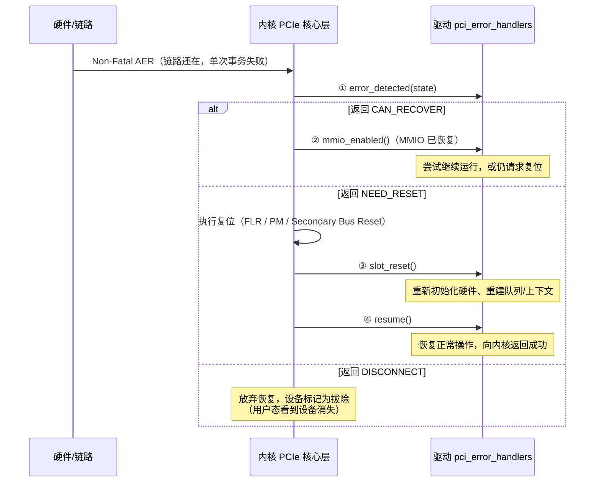

# 16 · AER 错误处理与链路稳定性

> **场景**：训练跑了几小时突然掉卡；`dmesg` 刷屏 `AER: Corrected error`；或者设备"还在但读写全 0"。这些都不是玄学，AER 把原因写在配置空间里了。
> **目标**：能读懂 AER 日志、区分"可纠正 / 非致命 / 致命"三档、知道该复位还是该换硬件。

---

## 一、AER 是什么

AER（Advanced Error Reporting，扩展能力 ID **0x0001**）给 PCIe 定义了一套**分层的错误上报机制**：

```
错误发生
   │
   ├─ 可纠正（Correctable）  → 计数 + 可选上报，链路自愈（重传）
   ├─ 非致命（Non-Fatal）    → 上报 OS，驱动可尝试恢复（复位设备）
   └─ 致命（Fatal）          → 链路/事务不可继续，通常需要端口级复位
```

它把错误从"一个中断线"细化到"**哪一类错、哪个设备、哪个 TLP**"，这是 PCI 时代做不到的。

---

## 二、寄存器布局（扩展配置空间，0x100+）

AER 能力内部偏移：

| 偏移 | 寄存器 | 作用 |
|------|--------|------|
| +0x00 | 扩展能力头 | Cap ID 0x0001 / Version / Next |
| +0x04 | **Uncorrectable Error Status** | 不可纠正错误状态（写 1 清零） |
| +0x08 | Uncorrectable Error Mask | 屏蔽位 |
| +0x0C | **Uncorrectable Error Severity** | 每一位设为 Fatal(1) 还是 Non-Fatal(0) |
| +0x10 | **Correctable Error Status** | 可纠正错误状态（写 1 清零） |
| +0x14 | Correctable Error Mask | 屏蔽位 |
| +0x18 | Advanced Error Capabilities and Control | **bit4:0 = First Error Pointer**；ECRC 相关 |
| +0x1C | **Header Log**（16 B） | 出错 TLP 的前 4 个 DW（含 Requester ID / Tag / 地址） |
| +0x2C | TLP Prefix Log | 支持前缀时的日志 |

> **First Error Pointer 很关键**：它指向"第一个出错的位"，能避免你被后续连锁错误误导。

**Root Port 额外有**：Root Error Command（使能上报）、Root Error Status（汇总 + 中断）、Error Source Identification（记录源设备 ID）。所以 `dmesg` 里报错的往往是 `pcieport 0000:00:01.0`（根端口），而不是出问题的叶子设备——**看日志要认 `(Receiver ID)` 和 `device [xxxx:yyyy]`**。

---

## 三、错误位速查（最常遇到的几位）

### 可纠正错误（Correctable Status）

| 位 | 名称 | 典型含义 |
|----|------|---------|
| 0 | Receiver Error | 接收端 8b/10b 或链路层解码错误 |
| 6 | **Bad TLP** | TLP 校验/格式错（**线缆/金手指/信号完整性**最常见） |
| 7 | Bad DLLP | 链路层包错 |
| 8 | REPLAY_NUM Rollover | 重传次数用尽 |
| 12 | **Replay Timer Timeout** | 等 ACK 超时（对端没回） |
| 13 | Advisory Non-Fatal | 建议性提示（常与 Corrected Internal 共存） |
| 14 | Corrected Internal Error | 设备内部自纠 |

### 不可纠正错误（Uncorrectable Status）

| 位 | 名称 | 语义 |
|----|------|------|
| 4 | Data Link Protocol Error | 链路层协议错（严重） |
| 5 | Surprise Down | 链路意外断开（**热插拔/掉卡**） |
| 7 | Poisoned TLP | 收到"毒化"TLP（上游已检出数据损坏） |
| 8 | Flow Control Protocol Error | 流控信用错乱 |
| 9 | **Completion Timeout** | 请求迟迟没有完成包（**设备挂死或地址错**） |
| 10 | Completer Abort | 对端拒绝完成该请求 |
| 11 | **Unexpected Completion** | 收到没有对应请求的完成包（**驱动/DMA 逻辑错**） |
| 12 | Receiver Overflow | 接收缓冲溢出 |
| 13 | **Malformed TLP** | TLP 结构非法（**驱动填了非法长度/地址**） |
| 15 | **Unsupported Request (UR)** | 访问了不存在的地址/功能（**BAR 偏移写错**最常见） |
| 16 | ACS Violation | 被 ACS 拦下（P2P 隔离生效） |
| 17 | Uncorrectable Internal | 设备内部不可纠正错 |
| 19 | AtomicOp Egress Blocked | 原子操作被禁止出口 |

> **经验映射**：
> - `Bad TLP / Replay Timer Timeout` 反复出现 → **物理层**（插槽、金手指、retimer、线缆）。
> - `Unsupported Request` 大量出现 → **软件访问了未映射地址**（BAR 偏移、64 位地址只写低 32 位）。
> - `Unexpected Completion / Malformed TLP` → **驱动描述符/长度字段填错**。
> - `Surprise Down` → 链路掉了（供电、热插拔、固件复位）。

---

## 四、读日志：一条真实格式的解析

```
pcieport 0000:00:01.0: AER: Corrected error received: 0000:01:00.0
pcieport 0000:00:01.0: AER: PCIe Bus Error: severity=Corrected, type=Data Link Layer, (Receiver ID)
pcieport 0000:00:01.0: AER:   device [1b36:0005] error status/mask=00000040/00002000
pcieport 0000:00:01.0: AER:    [ 6] Bad TLP
```

逐行读：

1. **报错者是根端口**（`00:01.0`），**出事的是 `01:00.0`**。
2. `severity=Corrected`：链路自己重传成功了，业务没受影响，但**说明物理层在劣化**。
3. `status/mask=00000040/00002000`：置位的是 bit6（0x40）= Bad TLP；mask 里 0x2000 是 bit13（Advisory Non-Fatal）被屏蔽。
4. `[ 6] Bad TLP`：内核已经把位翻译成名字。

**处置原则**：偶发几条可纠正错误可以观察；**持续增长**就要查物理层，别等到变成 `Surprise Down`。

```bash
# 看累计计数（内核按类别聚合，最直观）
cat /sys/bus/pci/devices/0000:01:00.0/aer_dev_correctable
cat /sys/bus/pci/devices/0000:01:00.0/aer_dev_nonfatal
cat /sys/bus/pci/devices/0000:01:00.0/aer_dev_fatal

# 看原始寄存器
lspci -vvv -s 0000:01:00.0 | grep -i -A12 "Advanced Error"
setpci -s 0000:01:00.0 ECAP_AER+0x10.l     # Correctable Status
setpci -s 0000:01:00.0 ECAP_AER+0x04.l     # Uncorrectable Status
# 若 pciutils 不认 ECAP_AER 符号名：先用 lspci -vvv 查 AER 能力实际偏移
# （形如 Capabilities: [100 v1] Advanced Error Reporting），再按 0x100+0x10 这类绝对地址读
```

---

## 五、三档错误分别怎么处理

| 级别 | 影响 | 处理方式 |
|------|------|---------|
| **Correctable** | 无（已重传） | 只统计。持续增长 → 查信号/接触/温度 |
| **Non-Fatal** | 单次事务失败 | 驱动 `error_detected()` 回调 → 复位设备 → `slot_reset()` → `resume()` |
| **Fatal** | 链路不可用 | 端口级复位（Secondary Bus Reset / FLR），必要时热插拔重新枚举 |

驱动侧对应 `struct pci_error_handlers` 的四个回调：

```c
static const struct pci_error_handlers my_err_handler = {
        .error_detected = my_error_detected,   /* 返回 PCI_ERS_RESULT_NEED_RESET 等 */
        .mmio_enabled   = my_mmio_enabled,     /* 可选：先试试 MMIO 还能不能用 */
        .slot_reset     = my_slot_reset,       /* 重新初始化硬件 */
        .resume         = my_resume,           /* 恢复正常操作 */
};
```

> 这是"设备热恢复"的标准路径。没有实现这套回调的驱动，遇到 Non-Fatal 只能靠用户态重置或重启。

> 图示：四个回调不是并列选项，而是**由驱动每一步的返回值决定的分支流程**——`error_detected()` 返回什么，直接决定内核走哪条路。这也是为什么只抄 `slot_reset` 而不实现 `error_detected` 的驱动，热恢复根本不会被触发。



### 手动复位

```bash
# 查看支持哪些复位方式
cat /sys/bus/pci/devices/0000:01:00.0/reset_method
# 触发复位（需要设备与驱动支持；先确认没在跑业务）
echo 1 | sudo tee /sys/bus/pci/devices/0000:01:00.0/reset
```

复位方式优先级：**FLR（Function Level Reset）> PM Reset > Bus Reset**。FLR 最轻，Bus Reset 会影响同总线上的其他设备。

---

## 六、DPC：把错误"关在端口里"

DPC（Downstream Port Containment，扩展能力 **0x001D**）是比 AER 更"硬"的机制：

```
检测到不可纠正错误
      │
      ▼
下游端口立即停止转发（链路被 containment）
      │
      ▼
产生 DPC 中断 → 软件记录 → 复位下游设备 → 恢复链路
```

**价值**：防止一个坏设备把错误扩散到整个 PCIe 域（尤其是多卡机器，一张卡出错拖垮整机）。

```bash
lspci -vvv -s 0000:00:01.0 | grep -i -A6 "Downstream Port Containment"
# 触发一次（危险：会真的隔离该端口，仅在测试环境用）
echo 1 | sudo tee /sys/bus/pci/devices/0000:00:01.0/dpc_trigger
```

---

## 七、链路稳定性：先排除物理层

AER 报 `Bad TLP` 时，90% 的问题不在软件。按这个顺序查：

```bash
# 1. 实际速率/宽度是否达标
lspci -vv -s 0000:01:00.0 | grep -iE "LnkCap|LnkSta"
#   LnkCap: Speed 16GT/s, Width x16
#   LnkSta: Speed 16GT/s, Width x16        ← 一致才正常
#   若 LnkSta 显示 8GT/s 或 x8 → 降速，查信号

# 2. 错误计数（跑业务前后各看一次，看增量）
for f in aer_dev_correctable aer_dev_nonfatal aer_dev_fatal; do
  echo "== $f"; cat /sys/bus/pci/devices/0000:01:00.0/$f
done

# 3. 链路训练相关日志
dmesg | grep -iE "link.*(down|retrain)|correctable|AER"

# 4. 温度/供电（加速卡过热会引发链路错误）
nvidia-smi -q -d TEMPERATURE,POWER 2>/dev/null || sensors
```

**物理层常见根因**：金手指氧化/脏污、插槽松动、PCIe 延长线/转接卡质量、retimer 固件、供电不足（尤其 12VHPWR）、机箱风道导致过热。

---

## 八、常用内核参数（排障时用，不要长期带）

| 参数 | 作用 | 风险 |
|------|------|------|
| `pci=noaer` | 关闭 AER 上报 | 掩盖问题，只用于确认"AER 本身是否在刷屏" |
| `pci=realloc` | 重新分配 BAR 资源 | 有时能救"BAR 未分配"的设备 |
| `pcie_ports=native` | 用内核原生 PCIe 服务（而非固件） | 影响热插拔/PME 行为 |
| `pci=resource_alignment=...` | 强制 BAR 对齐 | 大 BAR 设备（GPU）常用 |

> 这些参数应写在 `/etc/default/grub` 的 `GRUB_CMDLINE_LINUX_DEFAULT` 里，`update-grub` 后重启生效。**排障结束请去掉**。

---

## 九、自检

- [ ] 能说出 AER 的三档 severity 及各自处置方式
- [ ] 能读一条 `AER: Corrected error` 日志，指出"谁报的、谁出事的、哪一位"
- [ ] 知道 `Bad TLP` 与 `Unsupported Request` 分别指向物理层还是软件层
- [ ] 知道 `First Error Pointer` 的作用
- [ ] 能列出 `struct pci_error_handlers` 的四个回调及顺序
- [ ] 知道 DPC 解决什么问题（错误遏制，防扩散）
- [ ] 会用 sysfs 的 `aer_dev_*` 统计错误增量

---

## 🔗 关联笔记

- **配置空间基础**：[[14_配置空间与能力链表详解]]
- **驱动主线**：[[02_Linux_PCIe驱动开发]]
- **调试工具链**：[[04_优化与调试]]
- **P2P 隔离**：[[15_IOMMU_ACS与P2P可行性]]（ACS Violation 属于 AER 位 16）
- **集群稳定性**：[[集群高速IO问题排查]]
- **返回**：[[00_首页MOC]]

## 📝 我的记录

- **YYYY-MM-DD**：
