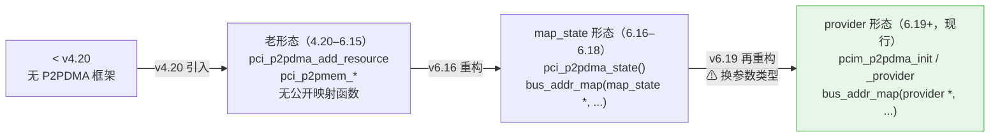

# 18 · 内核版本适配矩阵（写代码前先查这张表）

> **为什么需要这一篇**：本库核查中发现，同类错误里最难自查的一类是**"API 名字对、版本错"**——代码在 6.15 上编译通过，升到 6.19 就失败；或者照抄一篇 2024 年的博客，在 6.17 上写"新接口"却编译不过。
> **本篇所有版本号都来自逐 tag 拉取 `include/` 头文件比对**（方法见文末"如何自行复核"），不是二手资料。

---

## 一、先定位你的内核属于哪一段

```bash
# 一条命令拿到判定所需的三件事
uname -r                                   # 完整版本（含发行版后缀）
grep -E "CONFIG_PCI_P2PDMA|CONFIG_DMABUF" /boot/config-$(uname -r)
# P2PDMA 相关符号是否在你的头文件里（最可靠，能识别发行版 backport）
grep -l "pci_p2pdma_map_state"            /usr/src/linux-headers-$(uname -r)/include/linux/pci-p2pdma.h 2>/dev/null
grep -l "struct p2pdma_provider"          /usr/src/linux-headers-$(uname -r)/include/linux/pci-p2pdma.h 2>/dev/null
```

> ⚠️ **别只看 `uname -r` 的数字**。RHEL / SLES / Ubuntu HWE 会把新 API backport 进旧版本号，反过来也会把新 API 关在 `CONFIG_PCI_P2PDMA` 之外。**判定优先级：头文件里有没有这个符号 > 版本号。**
> `code/devcases/preflight.sh` 把这段判断做成了脚本，直接跑即可。

---

## 二、P2PDMA：一次重构，两次签名变更

这是本库最容易写错的地方，因为**同一个函数名在 6.19 换了参数类型**，跨版本升级会直接编译失败。

### 2.1 三个区间

| 区间 | 代表形态 | 关键符号 | 你要写什么 |
|------|---------|---------|-----------|
| **v4.20 – v6.15** | 老形态：provider 侧登记资源，client 侧走标准 DMA | `pci_p2pdma_add_resource()`、`pci_p2pmem_find()`、`pci_alloc_p2pmem()`、`pci_p2pdma_distance()` | **没有公开的"映射 P2P 地址"函数**。拿到 `p2pmem` 指针当普通内存用，`dma_map_sg()` 时由内核自行判断走向 |
| **v6.16 – v6.18** | 过渡形态：引入 map state 缓存判定结果 | `struct pci_p2pdma_map_state`、`pci_p2pdma_state(state, dev, page)`、`pci_p2pdma_bus_addr_map(struct pci_p2pdma_map_state *, phys_addr_t)` | 先 `pci_p2pdma_state()` 得到 `enum pci_p2pdma_map_type`，再据类型决定是否用 `bus_addr_map()` 手算总线地址 |
| **v6.19 +** | 抽象形态：provider 成为一等对象，可用 devres 托管 | `struct p2pdma_provider`、`pcim_p2pdma_init(pdev)`、`pcim_p2pdma_provider(pdev, bar)`、`pci_p2pdma_map_type(provider, dev)`、`pci_p2pdma_bus_addr_map(struct p2pdma_provider *, phys_addr_t)` | 用 `pcim_*` 拿 provider，再 `map_type()` 判类型。`map_state` 仍保留，但内部已指向 `provider`（兼容层，不要在新代码里用） |

> 图示：一次引入、两次重构的演进全貌。注意 `bus_addr_map` 这个名字**三段都在**，但参数类型换了两次——"函数名没变"恰恰是最容易麻痹的地方。



### 2.2 唯一会"编译直接炸"的地方

```c
/* 6.19 的签名 */
dma_addr_t pci_p2pdma_bus_addr_map(struct p2pdma_provider *provider, phys_addr_t paddr);

/* 6.16–6.18 的签名：同名，但第一个参数类型不同 */
static inline dma_addr_t
pci_p2pdma_bus_addr_map(struct pci_p2pdma_map_state *state, phys_addr_t paddr);
```

`struct pci_p2pdma_map_state` 与 `struct p2pdma_provider` 是**不兼容的两种类型**，传错会得到 `incompatible pointer type` 或 `passing argument 1 from incompatible pointer type`。**看到这个报错，第一反应就是版本区间搞错了。**

### 2.3 `enum pci_p2pdma_map_type` 的取值（三段一致，可放心用）

| 值 | 含义 | 工程处置 |
|----|------|---------|
| `PCI_P2PDMA_MAP_NOT_SUPPORTED` | 不可 P2P，必须经 CPU/主机桥中转 | 走 `memcpy` 或退回普通 DMA |
| `PCI_P2PDMA_MAP_BUS_ADDR` | 直接可用总线地址访问 | 最优路径，`paddr + bus_offset` |
| `PCI_P2PDMA_MAP_THRU_HOST_BRIDGE` | 可 P2P，但流量经 host bridge | 能跑，但带宽低、且依赖 ACS/白名单 |

> 同步记忆点：`pci_p2pdma_distance()` 返回 **-1 / 0 / 2 / 4**（不可 / 同功能 / 同设备不同功能 / 同 Switch），四个值，**没有 10**。详见 [[15_IOMMU_ACS与P2P可行性]]。

---

## 三、GPU 显存直访：peer-memory（专有）vs DMA-BUF（主线）

| 路线 | 归属 | 关键符号 | 可用性判定 |
|------|------|---------|-----------|
| **peer-memory** | **仅 MLNX_OFED**，从未进入主线 | `ib_register_peer_memory_client()`、`peer_mem.c` | `grep -r peer_mem /usr/src/linux-headers-$(uname -r)/` 无结果 = 你的内核没有 |
| **DMA-BUF** | 主线，v5.12 起 | 内核侧 `ib_umem_dmabuf_get()`；用户态 `ibv_reg_dmabuf_mr()` | 头文件里能搜到 `ib_umem_dmabuf_get` 即具备能力 |

**版本与生态要分开看**（这是核查中最容易被混淆的一点）：

| 层次 | 时间点 | 说明 |
|------|--------|------|
| 内核具备 DMA-BUF RDMA 能力 | **v5.12**（`ib_umem_dmabuf_get` 首现） | 这是硬门槛 |
| 用户态可用 | rdma-core 提供 `ibv_reg_dmabuf_mr` | 自检：`grep ibv_reg_dmabuf_mr /usr/include/infiniband/verbs.h` |
| 框架默认走这条路 | 较新版本的 NCCL 逐步默认 | 生态行为，不是内核限制。以 `NCCL_DEBUG=INFO` 日志里实际走的路径为准 |

> 所以"6.8 起才有 DMA-BUF"这个说法**不准确**——6.8 是社区讨论/生态切换的时间点，内核能力早在 5.12 就有。**写文档时把"内核能力"和"框架默认"分开说**，这是本库的一条写作规范。
> 详见 [[dev_case_03_peer_memory]] 与 [[11_GPUDirect与RDMA]]。

---

## 四、中断亲和：废弃与替代

| 符号 | 状态 | 首现/变更 |
|------|------|----------|
| `irq_set_affinity_hint()` | **已废弃**，头文件中有 `Deprecated` 注释 | 老接口，仍可用但会告警 |
| `irq_set_affinity_and_hint()` | 推荐替代 | **v5.17** |
| `irq_update_affinity_hint()` | 推荐替代（只更新 hint，不改实际亲和） | **v5.17** |
| `pci_alloc_irq_vectors_affinity()` | 一步到位分配 + 设亲和，最省事 | 长期存在，优先用它 |

```c
/* 推荐写法：让内核 API 自己处理 CPU 选择，别用 i % nr_cpu_ids */
irq_vecs = pci_alloc_irq_vectors_affinity(pdev, 1, nvec,
                                          PCI_IRQ_MSIX | PCI_IRQ_MSI,
                                          &affd);
```

> `i % nr_cpu_ids` 可能选到 isolated / nohz_full CPU，导致中断延迟抖动。用 `cpumask_local_spread(i, dev_to_node(&pdev->dev))` 或直接用 `pci_alloc_irq_vectors_affinity()`。详见 [[dev_case_04_多队列msix]]。

---

## 五、跨区间写一份代码：条件编译怎么写

```c
#include <linux/version.h>

#if LINUX_VERSION_CODE >= KERNEL_VERSION(6, 19, 0)
    /* provider 形态 */
    struct p2pdma_provider *prov = pcim_p2pdma_provider(pdev, bar);
    if (!prov) return -ENODEV;
    type = pci_p2pdma_map_type(prov, dev);
#elif LINUX_VERSION_CODE >= KERNEL_VERSION(6, 16, 0)
    /* map_state 形态 */
    struct pci_p2pdma_map_state st = { };
    type = pci_p2pdma_state(&st, dev, page);
#else
    /* 4.20–6.15：无映射接口，只用 p2pmem 分配 + 标准 DMA */
    type = PCI_P2PDMA_MAP_NOT_SUPPORTED;   /* 交给 dma_map_sg 决策 */
#endif
```

**三条实战建议**：

1. **优先"只支持一个区间"**。驱动通常绑定具体产品与内核基线，条件编译三层反而增加维护成本。
2. **backport 让版本号不可信**。发行版可能把 6.19 的 provider 移植到 6.6 内核，此时 `LINUX_VERSION_CODE` 判断会走错分支——这种情况只能靠 `grep` 头文件确认，或直接以目标发行版为唯一基线。
3. **别用"函数是否存在"做判断**。C 里无法 `#if defined(func_name)`（函数不是宏），要么版本号，要么在 Kbuild 里探测。

---

## 六、自检速查表（复制即用）

```bash
K=/usr/src/linux-headers-$(uname -r)

# P2PDMA 形态
grep -q "struct p2pdma_provider" $K/include/linux/pci-p2pdma.h && echo "provider 形态（6.19+）"
grep -q "pci_p2pdma_map_state"   $K/include/linux/pci-p2pdma.h && echo "map_state 形态（6.16–6.18）"
grep -q "pci_p2pdma_add_resource" $K/include/linux/pci-p2pdma.h && echo "老形态（4.20+）"

# peer-memory 是否可用（主线应为空）
grep -rl "ib_register_peer_memory_client" $K/ 2>/dev/null || echo "主线无 peer-memory（需 MLNX_OFED）"

# DMA-BUF RDMA 能力
grep -q "ib_umem_dmabuf_get" $K/include/rdma/ib_umem.h && echo "具备 DMA-BUF RDMA"

# 中断亲和新接口
grep -q "irq_set_affinity_and_hint" $K/include/linux/interrupt.h && echo "5.17+ 亲和接口可用"
```

---

## 七、如何自行复核本表（方法可复现）

```bash
# 逐个 tag 拉头文件，看符号在哪一版首次出现
for v in v6.15 v6.16 v6.17 v6.18 v6.19; do
  curl -s "https://git.kernel.org/pub/scm/linux/kernel/git/torvalds/linux.git/plain/include/linux/pci-p2pdma.h?h=$v" \
    | grep -c "struct p2pdma_provider" | xargs echo "$v provider:"
done
```

> **为什么不查 GitHub raw**：大文件会触发 429 限流，返回的是错误页而不是源码，`grep -c` 得到 0，会让你误判"符号不存在"。**这是核查过程中真实踩过的坑**——0 匹配既可能是"没有"，也可能是"没下到"，必须用 `curl -w "%{http_code} %{size_download}"` 复核下载是否正常。

---

## 🔗 关联笔记

- **P2P 可行性判定**：[[15_IOMMU_ACS与P2P可行性]]
- **案例**：[[dev_case_02_p2pdma]] · [[dev_case_03_peer_memory]] · [[dev_case_04_多队列msix]]
- **驱动主线**：[[02_Linux_PCIe驱动开发]] · [[03_多卡互联设计]]
- **带宽口径**：[[17_带宽与单位换算速查]]
- **返回**：[[00_首页MOC]]
