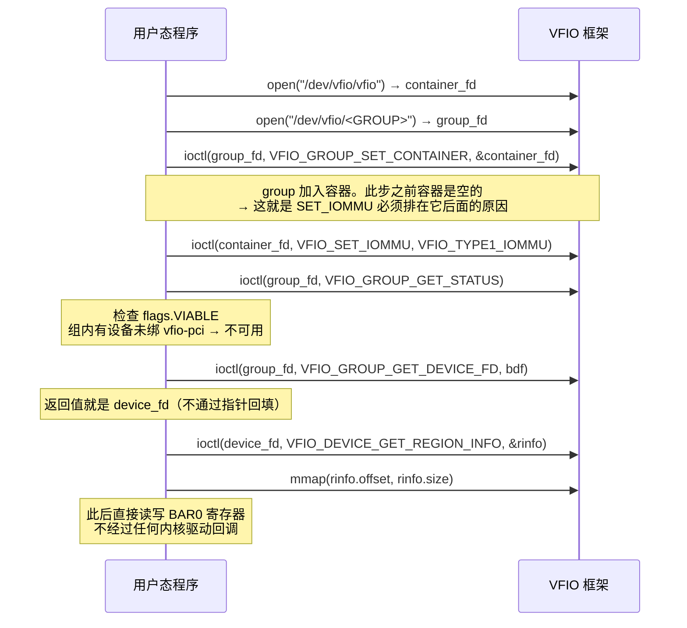

# Lab 04 · VFIO 用户态驱动：不写内核模块也能摸到真硬件

> **前置**：[[02_Linux_PCIe驱动开发]]（理解 BAR/DMA 概念）　|　**排错**：[[troubleshooting]]　|　**进度**：[[学习进度追踪]]

> **这是整个学习包最安全、最推荐的上手实验**：不写内核模块、不怕 panic、不需要自定义硬件。用 VFIO 把一块现成网卡/NVMe 绑给用户态，写一个用户态程序直接 `mmap` 它的 BAR、`readl/writel` 寄存器。

---

## 一、为什么 VFIO 是"最安全"的上手路径

| | 内核模块（lab_01） | VFIO 用户态（本篇） |
|---|---|---|
| 代码出错后果 | **可能 panic 整个内核** | 只是你自己的进程崩，系统无恙 |
| 需要写内核代码 | 是（probe/remove/ISR） | **否**，纯用户态 C 程序 |
| 需要自定义硬件 | 改 ID probe 真设备有风险 | 用现成网卡/NVMe，安全 |
| 学到什么 | 驱动框架全流程 | 设备的 BAR/寄存器/DMA 是怎么被访问的 |

**核心洞察**：内核驱动的本质是"把设备的 BAR 映射进来 + 配置 DMA + 处理中断"。VFIO 把这套**原样暴露给用户态**——你用普通 C 程序就能做内核驱动做的事。这也是 DPDK、SPDK、QEMU 自身访问设备的方式。

---

## 二、VFIO 工作原理（3 分钟）

```
内核 VFIO 子系统
   │  把设备的 BAR / 中断 / DMA 能力
   ▼  通过 /dev/vfio/N 这个设备文件暴露给用户态
用户态程序（你的 C 程序）
   ├─ open("/dev/vfio/N")
   ├─ ioctl: 获取设备信息（多少个 BAR/region）
   ├─ mmap: 把 BAR 映射进用户进程地址空间
   └─ 直接 readl/writel 访问设备寄存器
```

**关键前提**：设备必须**从原驱动解绑**，并交给 `vfio-pci` 管理。同时需要 **IOMMU**（Intel VT-d / AMD-Vi）做地址隔离和保护。

---

## 三、环境准备（含 BIOS 开 IOMMU）

### 1. BIOS 开启 IOMMU（硬件虚拟化支持）
- Intel：BIOS 里开 `VT-d`（不是 VT-x）
- AMD：开 `AMD-Vi` / `IOMMU`

### 2. 内核开 IOMMU（启动参数）
```bash
# 编辑 grub
sudo vim /etc/default/grub
# 找到 GRUB_CMDLINE_LINUX_DEFAULT，加上：
#   Intel:  intel_iommu=on iommu=pt
#   AMD:    amd_iommu=on iommu=pt
sudo update-grub
sudo reboot
```

### 3. 验证 IOMMU 已开启
```bash
# 方法1：看 dmesg
sudo dmesg | grep -i -e DMAR -e IOMMU
# Intel 看到 "DMAR: IOMMU enabled"，AMD 看到 "AMD-Vi: ..."

# 方法2：看 /sys
ls /sys/kernel/iommu_groups/
# 有内容（一堆 group 编号）说明开成功了

# 方法3：查设备属于哪个 IOMMU group
cat /sys/bus/pci/devices/0000:01:00.0/iommu_group/type
# 输出非空 = 该设备被 IOMMU 管理
```

### 4. 装 VFIO 相关（一般内核自带）
```bash
lsmod | grep vfio
# 应看到 vfio_pci / vfio_iommu_type1 / vfio
# 没有则：
sudo modprobe vfio-pci
```

---

## 四、把设备绑给 vfio-pci（核心步骤）

### 1. 选一个"你不依赖它联网/不依赖它存盘"的设备
```bash
lspci -nn | grep -iE "ethernet|nvme"
# 例：01:00.0 Ethernet controller [0200]: Intel ... [8086:1533]
#     ↑ BDF              ↑厂商ID↑设备ID
```
> ⚠️ **不要选系统盘 NVMe 或你正在联网的网卡**，否则绑走后断网/掉盘。

### 2. 从原驱动解绑，绑到 vfio-pci
```bash
BDF=01:00.0   # 换成你选的

# 看当前绑的驱动
lspci -k -s $BDF
# Kernel driver in use: e1000e （举例）

# 解绑
echo $BDF | sudo tee /sys/bus/pci/drivers/e1000e/unbind

# 让 vfio-pci 认领这个设备（按厂商:设备ID）
echo "8086 1533" | sudo tee /sys/bus/pci/drivers/vfio-pci/new_id

# 确认绑上了
lspci -k -s $BDF
# Kernel driver in use: vfio-pci   ← 成功
```

### 3. 找到设备的 IOMMU group 编号
```bash
cat /sys/bus/pci/devices/$BDF/iommu_group
# 输出形如：/sys/kernel/iommu_groups/12 → group 号是 12
```

### 4. 给自己访问权限
```bash
GROUP=12   # 换成上一步的 group 号
sudo chown $(id -u):$(id -g) /dev/vfio/$GROUP
sudo chmod 666 /dev/vfio/$GROUP
```

---

## 五、用户态程序：直接读设备寄存器

下面这个程序做的事，**和内核驱动的 probe 一模一样**，只是跑在用户态：

```c
// vfio_probe.c — 用 VFIO 在用户态读 PCIe 设备寄存器（可直接编译运行）
// 编译：gcc -O2 -Wall -o vfio_probe vfio_probe.c
// 运行：sudo ./vfio_probe /dev/vfio/12 0000:01:00.0
#include <stdio.h>
#include <stdlib.h>
#include <stdint.h>
#include <string.h>
#include <errno.h>
#include <fcntl.h>
#include <unistd.h>
#include <sys/ioctl.h>
#include <sys/mman.h>
#include <linux/vfio.h>

#define CHECK_IOCTL(fd, req, arg, what)                              \
        do {                                                         \
                if (ioctl((fd), (req), (arg)) < 0) {                  \
                        fprintf(stderr, "%s: %s\n", (what), strerror(errno)); \
                        return 1;                                    \
                }                                                    \
        } while (0)

int main(int argc, char **argv)
{
        const char *group_path, *bdf;
        int container_fd, group_fd, device_fd;
        struct vfio_group_status gstatus = { .argsz = sizeof(gstatus) };
        struct vfio_device_info  dinfo    = { .argsz = sizeof(dinfo) };
        struct vfio_region_info  rinfo    = { .argsz = sizeof(rinfo) };
        volatile uint32_t *bar;
        void *map;

        if (argc < 3) {
                fprintf(stderr, "用法: %s /dev/vfio/<GROUP> <BDF>\n"
                                "例:   %s /dev/vfio/12 0000:01:00.0\n",
                        argv[0], argv[0]);
                return 1;
        }
        group_path = argv[1];
        bdf        = argv[2];

        /* 1. 打开容器与 group */
        container_fd = open("/dev/vfio/vfio", O_RDWR);
        if (container_fd < 0) { perror("open /dev/vfio/vfio"); return 1; }

        group_fd = open(group_path, O_RDWR);
        if (group_fd < 0) { perror("open vfio group"); return 1; }

        /* 2. 先把 group 加入容器 —— 顺序不能反！ */
        CHECK_IOCTL(group_fd, VFIO_GROUP_SET_CONTAINER, &container_fd,
                    "VFIO_GROUP_SET_CONTAINER");

        /* 3. 再设置容器的 IOMMU 类型（空容器上设置会返回 EINVAL） */
        CHECK_IOCTL(container_fd, VFIO_SET_IOMMU, VFIO_TYPE1_IOMMU,
                    "VFIO_SET_IOMMU");

        /* 4. 检查 group 是否可用；组内有设备没绑 vfio-pci 时不可用 */
        CHECK_IOCTL(group_fd, VFIO_GROUP_GET_STATUS, &gstatus,
                    "VFIO_GROUP_GET_STATUS");
        if (!(gstatus.flags & VFIO_GROUP_FLAGS_VIABLE)) {
                fprintf(stderr, "group 不可用：组内还有设备未绑定 vfio-pci\n");
                return 1;
        }

        /* 5. 取设备 fd：ioctl 的“返回值”本身就是 fd，不是写进参数 */
        device_fd = ioctl(group_fd, VFIO_GROUP_GET_DEVICE_FD, bdf);
        if (device_fd < 0) { perror("VFIO_GROUP_GET_DEVICE_FD"); return 1; }

        /* 6. 设备信息：几个 region（BAR）、几个 IRQ */
        CHECK_IOCTL(device_fd, VFIO_DEVICE_GET_INFO, &dinfo,
                    "VFIO_DEVICE_GET_INFO");
        printf("设备 %s: %u 个 region, %u 个 IRQ\n",
               bdf, dinfo.num_regions, dinfo.num_irqs);

        /* 7. BAR0 信息（region index 0 = BAR0） */
        rinfo.index = 0;
        CHECK_IOCTL(device_fd, VFIO_DEVICE_GET_REGION_INFO, &rinfo,
                    "VFIO_DEVICE_GET_REGION_INFO");
        printf("BAR0: size=0x%llx flags=0x%x\n",
               (unsigned long long)rinfo.size, rinfo.flags);

        if (!(rinfo.flags & VFIO_REGION_INFO_FLAG_MMAP)) {
                fprintf(stderr, "该 region 不支持 mmap\n");
                return 1;
        }

        /* 8. mmap：偏移必须用 rinfo.offset，不是 0 */
        map = mmap(NULL, rinfo.size, PROT_READ | PROT_WRITE,
                   MAP_SHARED, device_fd, (off_t)rinfo.offset);
        if (map == MAP_FAILED) { perror("mmap BAR0"); return 1; }

        bar = (volatile uint32_t *)map;
        printf("BAR0 前 4 个寄存器：\n");
        for (int i = 0; i < 4; i++)
                printf("  [0x%02x] = 0x%08x\n", i * 4, bar[i]);

        munmap(map, rinfo.size);
        close(device_fd);
        close(group_fd);
        close(container_fd);
        return 0;
}
```

> **三处必须写对（原示例的坑，已修正）**：
> 1. **顺序**：`VFIO_GROUP_SET_CONTAINER` 必须在 `VFIO_SET_IOMMU` 之前。容器里还没有 group 时设置 IOMMU 类型会返回 `EINVAL`。
> 2. **`struct vfio_group_status` 只有 `argsz` 和 `flags`**，没有 `num_devices` 字段（早期示例里写的 `gstatus.num_devices` 是臆造）。要数设备应遍历 `/sys/kernel/iommu_groups/N/devices/`。
> 3. **`VFIO_GROUP_GET_DEVICE_FD` 的返回值就是 fd**，不是通过指针参数回填。

> 图示：VFIO 初始化的固定顺序——每一步都依赖上一步建立的状态，**顺序错了不是"可能失败"，而是必然 `EINVAL`**。横轴是用户态程序发起的调用，纵轴时间自上而下。



---

## 六、再进一步：VFIO + DMA

VFIO 还能让用户态程序**配置 DMA**（让网卡直接把数据写进你用户态的 buffer）：

1. 用户态 `malloc` 一块 buffer
2. 用 `ioctl(VFIO_IOMMU_MAP_DMA)` 把这块 buffer 注册给 IOMMU，拿到 **IOVA**（设备能访问的地址）
3. 把 IOVA 写进网卡的 DMA 描述符
4. 网卡 DMA 直接到你用户态 buffer —— 这就是 DPDK 收发包的原理

> 这套"用户态 + VFIO + DMA"组合，就是 **DPDK（网络）、SPDK（存储）** 的底层机制。理解了本篇，你就理解了这两个高性能框架为什么快。

---

## 七、恢复设备（玩完记得还回去）

```bash
# 把设备还给原驱动
echo "8086 1533" | sudo tee /sys/bus/pci/drivers/vfio-pci/remove_id
echo 01:00.0  | sudo tee /sys/bus/pci/drivers/e1000e/bind
```

---

## 八、自检

- [ ] 知道 VFIO = 把设备的 BAR/DMA/中断暴露给用户态
- [ ] 知道用 VFIO **不需要写内核模块**，不会 panic
- [ ] 能把一块网卡从原驱动解绑、绑给 vfio-pci
- [ ] 能用用户态程序 `mmap` BAR 并读到非零寄存器值
- [ ] 理解 VFIO + DMA 就是 DPDK/SPDK 的高性能基础
- [ ] 玩完知道怎么把设备还给原驱动

---

## 🔗 关联笔记

- **前置**：[[02_Linux_PCIe驱动开发]]（BAR/DMA 概念）
- **对比**：[[lab_01_first_probe]]（内核态读 BAR，本篇是用户态等价）
- **零拷贝**：[[06_零拷贝专题]]（VFIO + DMA = 用户态零拷贝，DPDK 原理）
- **排错**：[[troubleshooting]]（IOMMU/绑定问题）
- **返回**：[[00_首页MOC]]

## 📝 我的学习记录

- **YYYY-MM-DD**：
